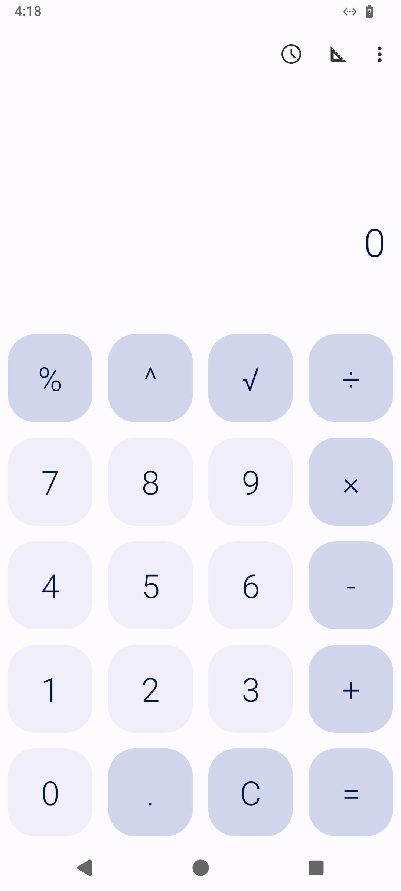

<a href="https://mobilebox.dev">
  <picture>
    <source media="(prefers-color-scheme: dark)" srcset=".github/readme/banner-dark.png">
    
  </picture>
</a>

<p align="center"><b>Smoke-test every Android build on a cloud Android phone, from any GitHub workflow.</b><br>Your APK goes onto a fresh phone, which opens it, waits for one text and keeps a screenshot. No emulator on the runner, and no KVM.</p>

<p align="center">
  <a href="https://mobilebox.dev">Website</a> ·
  <a href="https://mobilebox.dev/docs">Docs</a> ·
  <a href="#usage">Usage</a> ·
  <a href="https://github.com/fifteenA/mobilebox">Mobilebox for agents (MCP)</a>
</p>

<p align="center">
  <a href="../../actions/workflows/test.yml"></a>
  <a href="LICENSE"></a>
</p>

<p align="center"><b>~23 s</b> from fresh phone to verdict · <b>$0.01</b> per run · <b>1</b> step in your workflow · <b>0</b> phones left behind</p>
<p align="center"><sub>Times: create to pass on production, Fossify Calculator 1.4.0, three runs on 2026-11-06 (22.7–23.3 s). A run is one phone for its one-minute minimum.</sub></p>

## Usage

**1. Get a key.** [Sign up with GitHub](https://mobilebox.dev/signup) ($2 of credit, 200 runs) and create an agent key in the [dashboard](https://mobilebox.dev/dashboard). Add it to your repository as the secret `MOBILESANDBOX_API_KEY`.

**2. Add the step after your build.**

```yaml
# .github/workflows/android-smoke.yml
name: android-smoke
on:
  push:
    branches: [main]   # not pull_request: GitHub withholds secrets from fork PRs
  workflow_dispatch:
permissions:
  contents: read
jobs:
  smoke:
    runs-on: ubuntu-latest
    timeout-minutes: 15
    steps:
      - uses: actions/checkout@v7
      - uses: actions/setup-java@v6
        with:
          distribution: temurin
          java-version: 21
      - run: ./gradlew assembleDebug
      - uses: fifteenA/android-smoke-action@v1
        with:
          apk: app/build/outputs/apk/debug/app-debug.apk
          wait-for: Welcome
          api-key: ${{ secrets.MOBILESANDBOX_API_KEY }}
```

**3. Push.** The job fails when the text doesn't show, and the run's artifacts hold a screenshot of the screen the phone saw.

<p align="center">
  
  <br><sub>The artifact from a real run: unedited, straight from the phone.</sub>
</p>

## Inputs and outputs

| Input | Default | |
|---|---|---|
| `apk` | required | Path to the APK: arm64-v8a or universal. |
| `api-key` | required | Your Mobilebox key, from a secret. |
| `wait-for` | – | Text that proves launch, e.g. a button label. Empty: pass when the app is in the foreground after opening. |
| `timeout` | `60` | Seconds to wait for the text. |
| `artifact-name` | `android-smoke-screenshot` | Set it per call when one job calls the action twice. |

| Output | |
|---|---|
| `result` | `pass` or `fail` |
| `phone-id` | The phone the test ran on, e.g. `ph_ohloqltzhm4c` |
| `screenshot` | Path to the PNG of the last screen |

Use `continue-on-error: true` and `steps.<id>.outputs.result` to report instead of failing the job.

## What a run does

1. Creates a fresh Android 14 phone and waits until it is ready (boot time is free).
2. Uploads your APK, installs it with its permissions granted, and opens it.
3. Waits for `wait-for` on screen, or checks that the app is still in the foreground.
4. Saves a screenshot and uploads it as an artifact, on a pass and on a fail.
5. Deletes the phone: on a pass, on a fail, and when you cancel the job.

A lost create is retried with the same idempotency key, so a flaky network never makes a second phone.

| Log says | Next step |
|---|---|
| `"X" did not appear within 60 s` + screen text | Read the printed screen: a dialog, a crash, a splash screen or another language |
| `is not in the foreground` | The app closed after launch: check for a crash on startup |
| `unsupported_abi` | Build an arm64-v8a or universal variant |
| `insufficient_credits` | Add credit in the [dashboard](https://mobilebox.dev/dashboard) |
| `Cleanup failed` | Delete the phone from the dashboard |

Use a build that runs on its own: a React Native debug APK waits for a Metro server the phone can't reach. The printed screen lands in the CI log, so keep real accounts off the first screen.

## Try it locally

The step is one Node script without dependencies:

```bash
MOBILESANDBOX_API_KEY=... APK=app-debug.apk WAIT_FOR=Welcome node smoke.mjs
```

## Go further

The same phones are open to your coding agent over MCP: it can tap through the flows a smoke test can't reach, read the screen as numbered elements and tell you what broke. See [fifteenA/mobilebox](https://github.com/fifteenA/mobilebox).

---

Questions: hello@mobilebox.dev, or [open an issue](../../issues). [MIT](LICENSE) for this repository; the hosted service is covered by its [terms](https://mobilebox.dev/terms).
